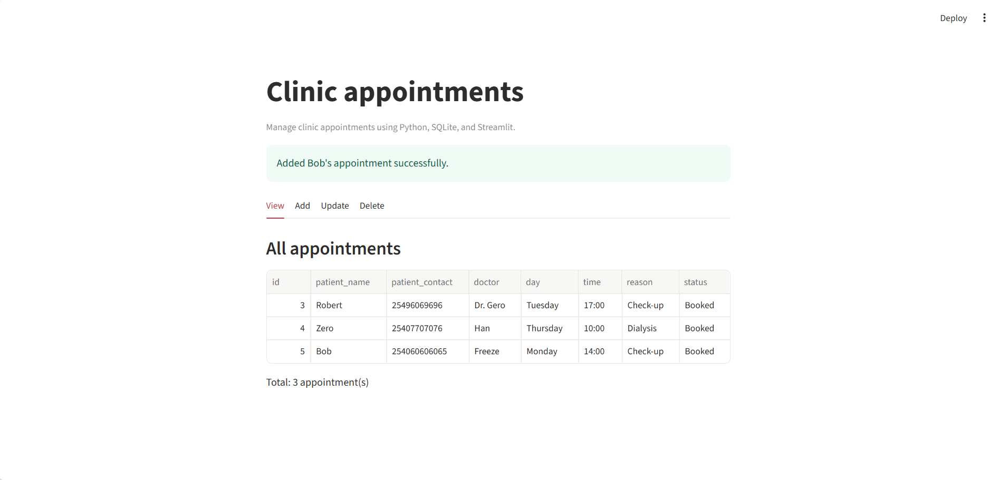
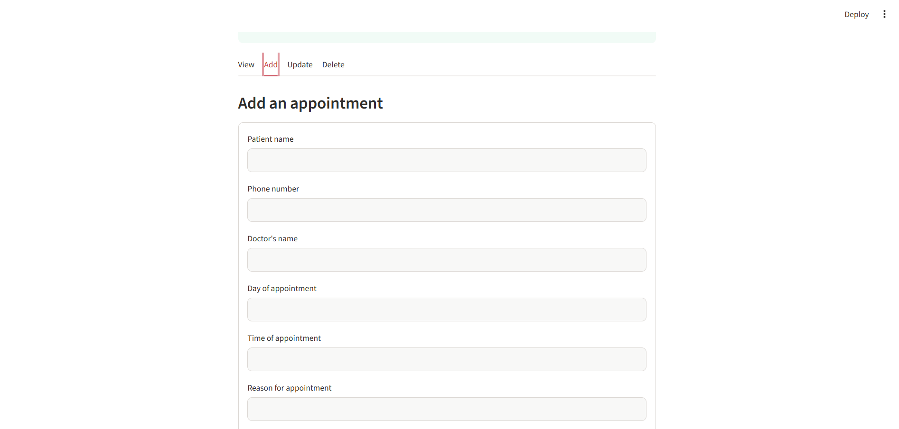

# Python_Capstone

Built to solve booking issues and conflicts in hospitals


# Cargo Tracker

> My project is built to solve booking issues and appointment tracking in hospitals

## Features
- Add, view, update and delete patient appointments
- Each patient gets an id
- See how many patients are on appointment
- View the whole project on streamlit

## Setup
```bash
git clone https://github.com/SmartGuy500/Python_Capstone.git
cd Python_Capstone
python -m venv .venv
source .venv/Scripts/activate    # Mac/Linux: source .venv/bin/activate
pip install -r requirements.txt
streamlit run main.py
```

## Screenshots



## Built with
Python, Streamlit, SQLite

## Future improvements
- Adding strict parameters for inputs eg. numbers must be in valid format, date and time must be valid values, etc.
- Alerts when a new appointment has been made